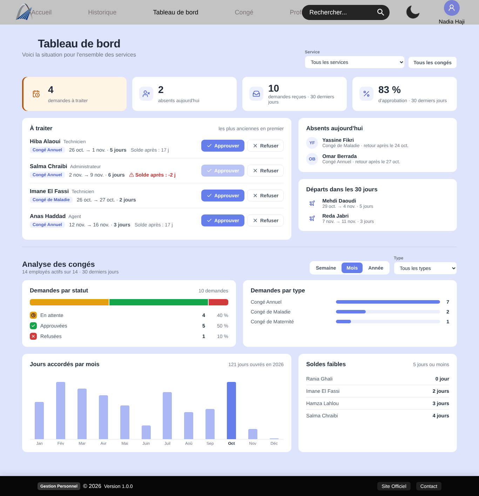
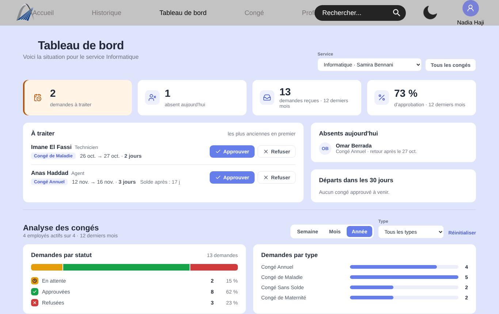
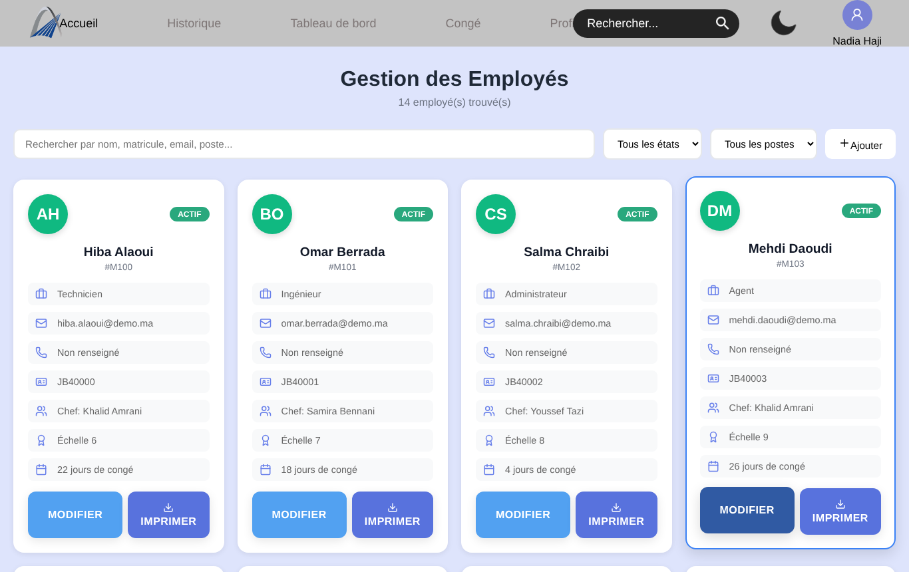
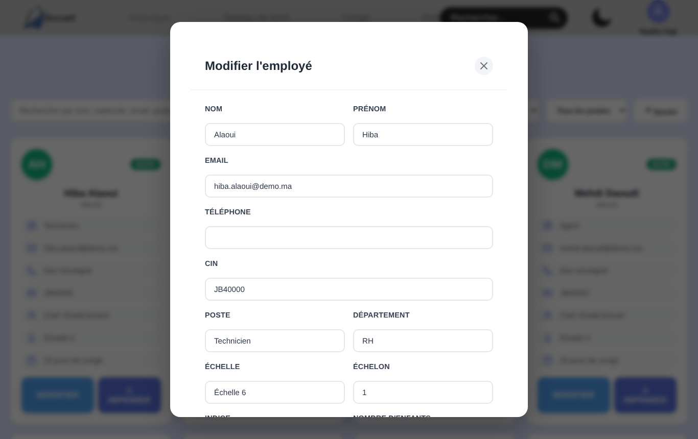
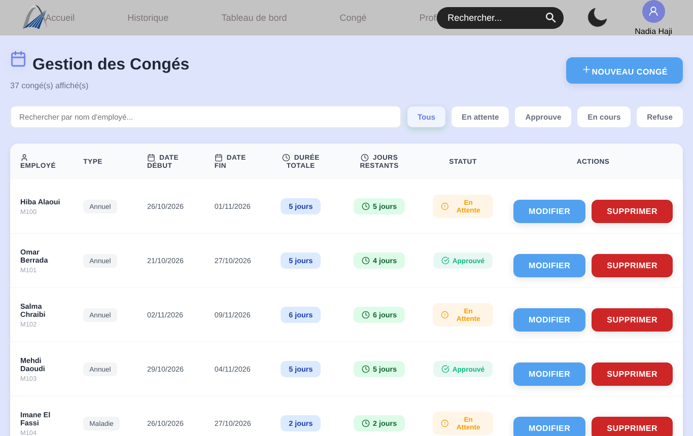
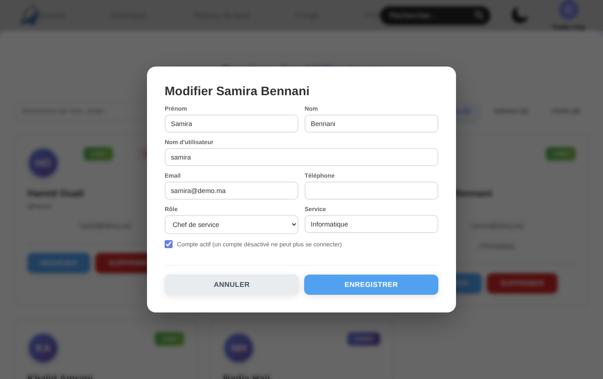
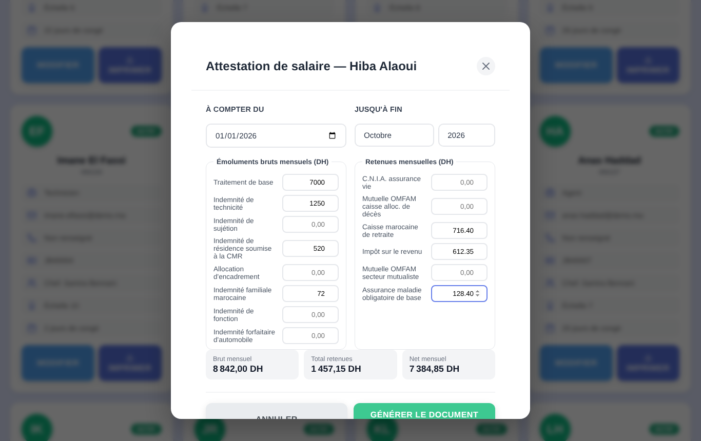
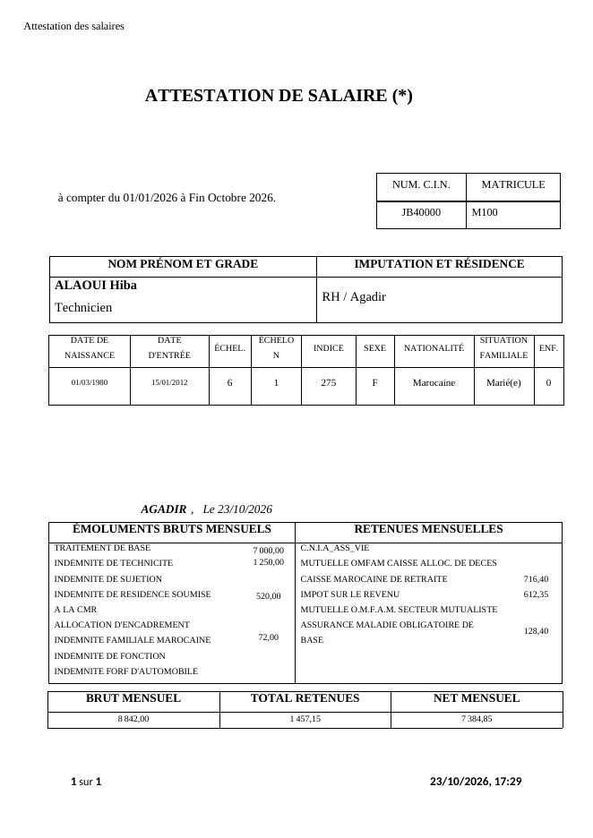
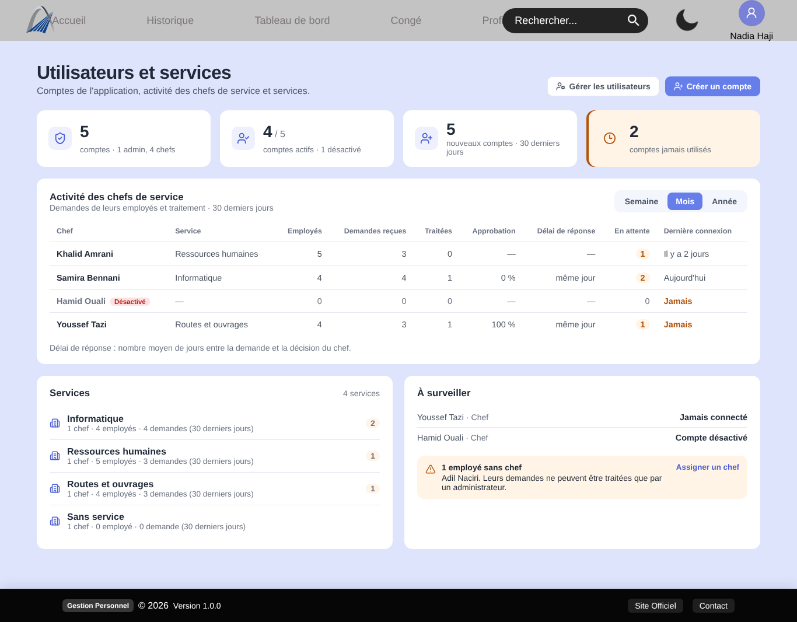
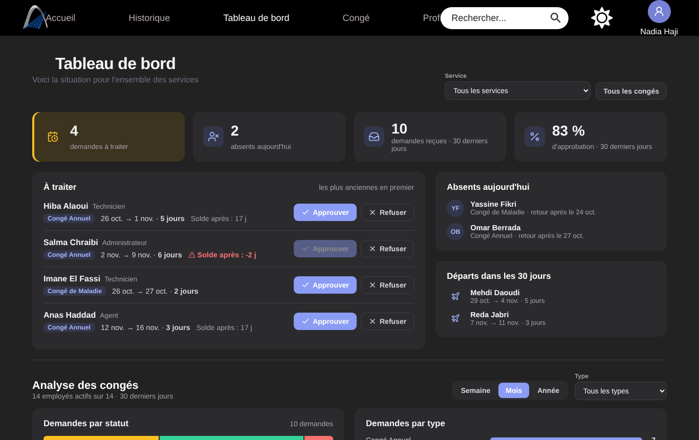

# Gestion du personnel et des congés

> Application web de gestion des employés d'une administration et de leurs demandes de congé : circuit de validation par le chef de service, soldes en jours ouvrés, historique des salaires, tableau de bord et génération d'attestations Word. Backend en **Django REST Framework**, frontend en **React + TypeScript**.
>
> **Ce dépôt est une vitrine technique.** Il présente l'architecture, le modèle de données et les choix de conception. Le code source est privé et peut être communiqué sur demande.

---

## Sommaire
- [Présentation](#présentation)
- [Captures d'écran](#captures-décran)
- [Technologies](#technologies)
- [Architecture](#architecture)
- [Modèle de données](#modèle-de-données)
- [Patrons de conception](#patrons-de-conception)
- [Fonctionnalités](#fonctionnalités)
- [Défis techniques](#défis-techniques)
- [Sécurité](#sécurité)
- [Tests](#tests)
- [Ce que j'ai appris](#ce-que-jai-appris)
- [Documentation](#documentation)
- [Contact](#contact)

---

## Présentation

Dans beaucoup d'administrations, les demandes de congé circulent encore sur papier ou dans des fichiers Excel : on ne sait pas qui est absent aujourd'hui, les soldes sont recalculés à la main, et une attestation de salaire se prépare en recopiant les informations de l'employé dans un modèle Word.

Cette application centralise tout cela. Un **chef de service** voit les demandes de ses employés, les approuve ou les refuse en un clic, et le solde est décompté automatiquement en **jours ouvrés**. Un **administrateur** gère les comptes, les employés et les salaires, suit l'activité de chaque service, et génère les **attestations officielles** à partir des modèles Word de l'administration.

| | |
|---|---|
| **Rôle** | Développeuse full stack |
| **Durée** | Juil. – août 2025 |
| **Type** | Projet personnel |
| **Statut** | Fonctionnel, 25 tests automatisés |

---

## Captures d'écran

> Toutes les captures utilisent des **données fictives**.

| | |
|:---:|:---:|
|  |  |
| **Tableau de bord** : demandes à traiter, absents, analyse | **Analyse filtrée** par service, période et type |
|  |  |
| **Employés** : recherche et filtres | **Fiche employé** : échelle, échelon, indice, situation familiale |
|  |  |
| **Congés** : suivi et circuit de validation | **Gestion des comptes** (admin) |
|  |  |
| **Attestation de salaire** : saisie, totaux calculés | **Document Word généré** depuis le modèle officiel |
|  |  |
| **Utilisateurs et services** : activité des chefs | **Mode sombre** |

---

## Technologies

| Couche | Technologie | Pourquoi |
|---|---|---|
| Frontend | React 19 + TypeScript + Vite | Interface réactive, typage des données de l'API, build rapide |
| Interface | Ant Design, Tailwind CSS, lucide-react | Composants prêts à l'emploi (messages, avatars) et icônes cohérentes |
| Appels API | Axios (intercepteurs) | Jeton ajouté à chaque requête, renouvellement automatique |
| Routage | React Router 7 | Routes protégées selon la connexion et le rôle |
| Documents | docxtemplater + PizZip + file-saver | Remplissage des modèles Word officiels directement dans le navigateur |
| Backend | Python + Django 5.2 + Django REST Framework | ViewSets, serializers et permissions déclaratives |
| Authentification | Simple JWT (rotation + liste noire) | Sessions sans état, jetons de rafraîchissement révocables |
| Filtres | django-filter | Recherche et filtres d'API sans code répétitif |
| Base de données | PostgreSQL | Intégrité référentielle, transactions, verrous de ligne |
| Configuration | python-dotenv | Secrets dans un fichier `.env`, jamais dans le code |
| Outils | Git, GitHub, tests Django (APITestCase) | Versionnage et non-régression |

---

## Architecture

```
┌──────────────────────────────────────────────────────────┐
│  CLIENT  (React + TypeScript)                             │
│  Pages → services (Axios) → API                           │
│  AuthContext · routes protégées · thème clair / sombre    │
│  Génération Word côté client (docxtemplater)              │
└──────────────────────────┬───────────────────────────────┘
                           │ REST / JSON   (Authorization: Bearer <JWT>)
┌──────────────────────────▼───────────────────────────────┐
│  URLS + ROUTER     /api/auth · /api/employes · /api/conges │
├──────────────────────────────────────────────────────────┤
│  VUES              APIView · ViewSets · actions dédiées    │
│                    (/traiter/, /annuler/, /changer_etat/)  │
├──────────────────────────────────────────────────────────┤
│  PERMISSIONS       rôle (admin / chef) + droits par objet  │
│  QUERYSETS         cloisonnés : un chef ne voit que        │
│                    ses employés                            │
├──────────────────────────────────────────────────────────┤
│  SERIALIZERS       validation, champs en lecture seule,    │
│                    champs réservés à l'admin               │
├──────────────────────────────────────────────────────────┤
│  MODÈLES           règles métier : approuver(), refuser(), │
│                    annuler(), duree() en jours ouvrés      │
└──────────────────────────┬───────────────────────────────┘
                     ┌─────▼──────┐
                     │ PostgreSQL │
                     └────────────┘
```

**Principe central : le statut d'un congé ne se modifie jamais directement.** Un congé passe de « en attente » à « approuvé », « refusé » ou « annulé » uniquement par des actions dédiées. Chacune vérifie la règle métier, met à jour le solde de l'employé et enregistre qui a décidé, dans une seule transaction.

**Parcours d'une approbation :**

```
POST /api/conges/42/traiter/   {"action": "approuver"}
  → JWTAuthentication        vérifie le jeton, identifie l'utilisateur
  → CanApproveLeave          rôle chef ou admin
  → get_queryset()           le congé 42 appartient-il à un employé du chef ? sinon 404
  → Conge.approuver()        @transaction.atomic
       ├─ select_for_update  verrouille la ligne de l'employé
       ├─ vérifie le solde   en jours ouvrés
       ├─ déduit les jours
       └─ statut, traite_par, date_reponse
  ← 200 { message, conge }
```

Détails dans [docs/ARCHITECTURE.md](docs/ARCHITECTURE.md).

---

## Modèle de données

```
Respo (utilisateur : admin ou chef) ──1:1── ChefInfo (service)
   │
   ├──1:N── Employe ──1:N── Conge ──N:1── Respo (traité par)
   │           │
   │           └──1:N── HistoriqueSalaire ──N:1── Respo (modifié par)
```

Les **employés ne sont pas des utilisateurs** : seuls les administrateurs et les chefs de service se connectent. Ce choix correspond au fonctionnement réel d'une administration, où c'est le chef qui saisit et traite les demandes.

| Entité | Champs clés |
|---|---|
| `Respo` | rôle (admin / chef), téléphone, photo ; étend l'utilisateur Django |
| `ChefInfo` | service dirigé par le chef |
| `Employe` | matricule (clé), CIN, identité, poste, département, échelle, échelon, indice, situation familiale, enfants, état, solde de congés, salaire |
| `Conge` | type, dates, statut, motif, réponse du chef, traité par, date de réponse |
| `HistoriqueSalaire` | ancien et nouveau salaire, type de modification, pourcentage calculé, motif, date d'effet |

**Les montants utilisent `Decimal`** (arithmétique décimale exacte). L'âge, l'ancienneté et la durée d'un congé sont **calculés**, jamais saisis.

Détails dans [docs/database-schema.md](docs/database-schema.md).

---

## Patrons de conception

| Patron | Où | Problème résolu |
|---|---|---|
| **Modèle riche (fat model)** | `Conge.approuver()`, `refuser()`, `annuler()` | Les règles métier sont au même endroit, quelle que soit la vue qui les appelle |
| **Transaction atomique + verrou** | `@transaction.atomic`, `select_for_update()` | Le solde ne peut pas être décompté deux fois, ni à moitié |
| **ViewSet + Router** | `EmployeViewSet`, `CongeViewSet` | Routes REST standard, plus des actions métier nommées |
| **Un serializer par usage** | liste / détail / écriture | Chaque réponse expose exactement ce dont l'écran a besoin |
| **Permissions par objet** | `permissions.py` | Les droits sont déclarés une fois, pas re-vérifiés dans chaque vue |
| **Querysets cloisonnés** | `get_queryset()` selon le rôle | Une donnée hors périmètre renvoie 404 : on ne peut même pas deviner qu'elle existe |
| **Valeurs dérivées** | âge, ancienneté, durée, statistiques | Une seule source de vérité, pas de chiffres qui divergent |
| **Modèle de document** | docxtemplater | L'administration garde la main sur la mise en page de ses attestations |
| **Contexte + routes protégées** | `AuthContext`, `ProtectedRoute` | Session et rôle accessibles partout dans l'interface |
| **Intercepteurs** | Axios | Jeton ajouté automatiquement, renouvelé quand il expire |

---

## Fonctionnalités

- **Deux rôles** : l'admin gère tout ; le chef de service gère uniquement ses employés
- **Employés** : fiche complète (identité, CIN, poste, échelle, échelon, indice, situation familiale, nationalité), recherche et filtres, changement d'état (actif, en congé, retraité, muté…)
- **Congés** : demande, approbation ou refus motivé, annulation avec recrédit des jours
  - décompte en **jours ouvrés** (sans les week-ends)
  - contrôles : dates cohérentes, pas de chevauchement avec un congé déjà approuvé, solde suffisant
- **Tableau de bord** : demandes à traiter avec approbation en un clic, absents du jour, départs à venir, soldes faibles
- **Analyse filtrable** par service, période et type : demandes par statut, taux d'approbation, répartition par type, jours accordés par mois
- **Utilisateurs et services** (admin) : comptes actifs ou jamais utilisés, activité de chaque chef (taux d'approbation, **délai moyen de réponse**), employés sans chef
- **Historique des salaires** : chaque augmentation ou ajustement est tracé, avec le pourcentage calculé automatiquement
- **Attestations Word** : attestation de travail et attestation de salaire générées depuis les modèles officiels, avec calcul du brut, des retenues et du net
- **Gestion des comptes** : création, modification, désactivation, suppression sécurisée
- Mode clair et mode sombre

---

## Défis techniques

**Sécuriser le circuit de validation.** Dans une première version, le statut d'un congé était un champ modifiable comme les autres : un simple `PATCH {"statut": "approuve"}` contournait la validation, sans décompter les jours. Le statut est désormais en lecture seule, et seules les actions `/traiter/` et `/annuler/` peuvent le changer.

**Cloisonner les données entre chefs.** Chaque chef ne doit voir que son service. Le filtrage se fait dans le `get_queryset()` de chaque vue, et les permissions par objet ajoutent une seconde barrière. Un congé d'un autre service renvoie **404** plutôt que 403, pour ne pas révéler son existence.

**Deux approbations en même temps.** Si deux personnes approuvent deux demandes du même employé à la même seconde, elles lisent le même solde et l'employé obtient plus de jours qu'il n'en a. La ligne de l'employé est donc verrouillée (`select_for_update`) pendant la transaction : les approbations passent l'une après l'autre.

**Remplir un modèle Word officiel.** L'attestation de salaire de l'administration utilise des zones de texte, que Word enregistre en double dans le fichier (version moderne et version de compatibilité). Chaque champ a reçu un nom unique dans les deux versions, puis le document est rempli dans le navigateur avec docxtemplater. La mise en page officielle n'est jamais recréée en code.

**Des listes tronquées sans erreur.** L'API envoie ses résultats par pages de 10, mais l'interface ne lisait que la première : au-delà de 10 employés, les suivants disparaissaient sans message. Une fonction `fetchAll` suit désormais les pages jusqu'à la dernière.

**Des statistiques honnêtes.** Une ancienne version affichait des estimations (« nombre de congés ≈ 2,5 × nombre d'utilisateurs ») quand l'API ne répondait pas. Elles ont été remplacées par de vrais calculs côté serveur ; en cas d'erreur, la page le dit.

---

## Sécurité

- Authentification JWT : jeton d'accès de 30 minutes, jeton de rafraîchissement en rotation, **liste noire** à la déconnexion
- Mots de passe hachés par Django et validés (longueur, mots courants, similarité)
- **Contrôle d'accès systématique** : rôle vérifié par les permissions, périmètre vérifié par les querysets, droits vérifiés sur chaque objet
- Champs sensibles en lecture seule : statut d'un congé, salaire et solde pour un chef, droits Django pour tous
- Garde-fous : un admin ne peut ni se supprimer, ni se retirer ses droits ; le dernier admin ne peut pas être supprimé
- Validation des données à l'entrée (serializers) et dans le modèle (`clean()`)
- CORS limité à l'origine du frontend
- Secrets (clé Django, mot de passe de la base) dans des variables d'environnement, jamais dans le code

---

## Tests

**25 tests automatisés** (`APITestCase`) vérifient le comportement de l'API, notamment :
- le cloisonnement entre chefs ;
- le circuit de validation et le décompte des jours ;
- les champs réservés à l'admin ;
- le calcul en jours ouvrés ;
- la gestion des comptes ;
- le tableau de bord et ses filtres ;
- les statistiques.

Lancés sur la première version du code, 10 des 11 premiers tests échouaient : ils ont mis en évidence les failles corrigées ensuite.

Détails dans [docs/tests.md](docs/tests.md).

---

## Ce que j'ai appris

- Une règle métier qui peut être contournée par un `PATCH` n'est pas une règle : le circuit de validation doit être imposé par le serveur, pas par l'interface
- La sécurité se joue au niveau des données (querysets), pas seulement au niveau des pages
- Une opération qui modifie deux tables doit être atomique, et une opération concurrente doit être verrouillée
- Un chiffre calculé vaut mieux qu'un chiffre stocké, et un chiffre réel vaut mieux qu'une estimation
- Écrire les tests révèle les failles : plusieurs bugs n'ont été vus qu'en les écrivant
- Respecter les documents existants d'une administration (modèles Word) plutôt que de les réinventer

---

## Documentation

| Document | Contenu |
|---|---|
| [Architecture](docs/ARCHITECTURE.md) | Couches, cycle d'une requête, circuit de validation, choix et compromis |
| [API](docs/api.md) | Tous les points d'API, rôles autorisés, paramètres, codes de réponse |
| [Base de données](docs/database-schema.md) | Tables, relations, index, choix de modélisation |
| [Frontend](docs/front-end.md) | Pages, routage, état, appels API, génération des documents |
| [Tests](docs/tests.md) | Stratégie de test et liste des cas couverts |
| [Structure du projet](STRUCTURE.md) | Organisation des dossiers du vrai code |
| [.env.example](.env.example) | Variables de configuration nécessaires (noms uniquement) |
---


*Code source disponible sur demande.*
